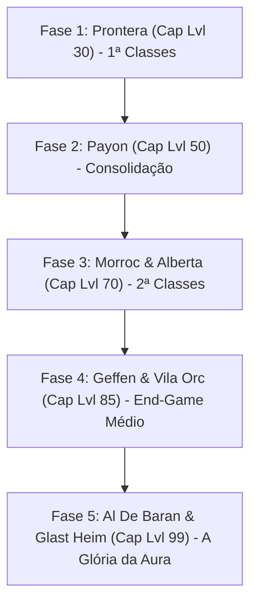
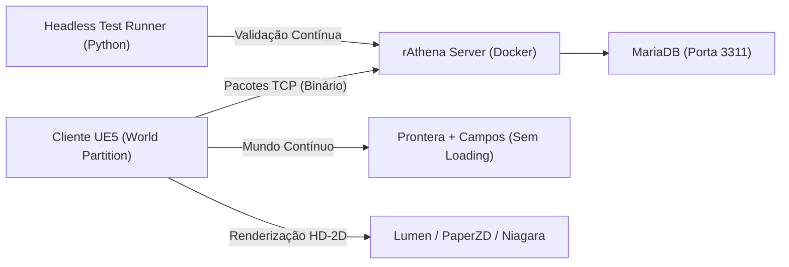

# ⚡ Myth of Thor Project

> Recriação nostálgica e moderna de **Ragnarok Online** no estilo **HD-2D** na **Unreal Engine 5**, conectada ao emulador oficial **rAthena** via protocolo de rede nativo de pacotes TCP.

---

## 🎯 1. Visão & Filosofia do Projeto

* **Experiência Justa & Sem ROPs:** Modelo econômico puramente clássico e progressivo. Itens que antes eram vendidos por dinheiro real (ROPs) são conquistados através de Quests temáticas pelo mundo. Manutenção do servidor viabilizada através de doações voluntárias com VIP exclusivamente cosmético/QoL.
* **Mundo Contínuo por Regiões (Seamless Open World):** Fim dos portais azuis e telas pretas de transição entre cidades e campos. O jogador cruza as muralhas de Prontera e entra diretamente nos campos abertos sem cortes de câmera ou loading (via **World Partition** na UE5).
* **Transições Temáticas Entre Grandes Zonas:** Viagens de barco (Alberta), aeroplano ou grandes cordilheiras utilizam telas de carregamento ilustradas com artes conceituais clássicas de Ragnarok.
* **Dungeons Híbridas:** Entrada natural pela boca de cavernas sem corte; transição suave entre andares subterrâneos profundos (escadas e alçapões) com **Fade-out suave de 0.5s para preto** e ambientação sonora imersiva (evitando sobreposição de NavMesh e isolando a iluminação Lumen por andar).
* **Visual HD-2D na Unreal Engine 5:** Cenários 3D clássicos com iluminação dinâmica global (**Lumen**), reflexos em tempo real e sprites 2D com animações preservadas (**PaperZD**).
* **Ciclo Dia/Noite & Clima Dinâmico:** Transição suave entre dia, entardecer e noite (postes de luz acendendo em Prontera) e sistema de partículas (**Niagara**) para chuva, poças d'água reflexivas e neblina.
* **Áudio Dinâmico Seguro:** Trilhas originais preservadas intactas (`Theme of Prontera`, etc.), recebendo filtro noturno em tempo real (*Low-Pass Filter*) com sons sutis de grilos e vento à noite sem alterar arquivos originais.
* **Controles Duais Simultâneos:** Suporte total a **Point & Click (Mouse clássico)** e **WASD (Teclado moderno)** sem necessidade de trocar opções. Câmera configurável entre **Isométrica Fixa** e **Livre 360°**.
* **Combate Clássico:** Textos flutuantes clássicos de dano saltando na tela (amarelo/branco para dano causado, vermelho para dano sofrido e o clássico `MISS` em azul).

---

## 🌟 2. Sistema de Especializações (Skill Morph) & Recompensa Justa de MVP

### A. Posturas de Papel (Role Modifiers) Desde as 1ª Classes
Em vez de magias genéricas estranhas que descaracterizam as classes, o jogador escolhe uma **Postura de Papel** (*Vanguarda/Tanque*, *Guardião/Healer*, *Combatente/DPS*, *Arcanista/DPS Mágico*) que aprimora as habilidades que a classe já possui:
* **Ativo Imediatamente nas 1ª Classes:** Como a Fase 1 possui Level Cap no nível 30, a luta contra o primeiro MVP (**Besouro-Ladrão Dourado - GTB**) nos Esgotos de Prontera será travada exclusivamente por 1ª classes (Espadachim, Noviço, Mago, Arqueiro, Gatuno, Mercador) com suas especializações ativas!
* **Exemplos de Modificadores:**
  * *Noviço Guardião:* *Bênção* e *Aumentar Agilidade* viram em área para toda a party ao redor com 1 clique.
  * *Noviço Arcanista:* *Luz Divina* e *Magnus Exorcismus* causam dano a qualquer elemento de monstro.
  * *Espadachim Vanguarda:* *Provocar* vira **Taunt Real de 6s** (trava o aggro de monstros e chefes no Tanque).
  * *Ferreiro Guardião:* *Manejo Perfeito* e *Adrenalina Pura* afetam as armas e magias de todo o grupo.

### B. Novo Cálculo de MVP: O Fim da Injustiça com Tanques e Suportes
No Ragnarok original, quem dava o último golpe ou tinha dano explosivo (ex: Asura) roubava todo o drop do MVP. No Myth of Thor:
* **Threat Score (Pontuação de Ameaça):** O Tanque que gastou poções, segurou os golpes do MVP e protegeu o grupo pontua no ranking do MVP por **Dano Mitigado / Tempo de Ameaça**.
* **Recompensa por Participação / Baú de MVP:** Todos os papéis essenciais (Tanque segurando o boss, Healer mantendo o grupo vivo e DPS causando dano) recebem sua fatia justa dos drops e recompensas diretamente no inventário.

---

## ⏱️ 3. Sistema de Auto-Battle (Vigor Diário de 3h & Risco Real)

* **Limite Diário:** Cada jogador possui **3 horas (180 minutos / 10.800s)** de Auto-Battle por dia, resetando às 00:00 do servidor.
* **Trava de Sobrepeso:** O Auto-Battle é pausado automaticamente caso o inventário atinja $\ge 90\%$ de capacidade de carga.
* **Morte no Auto-Battle (Risco vs. Recompensa):**
  * **Penalidade Agravada:** Perda de **5% de EXP Base** ao morrer em modo automático (contra 1% da morte manual).
  * **Desativação Instantânea:** O modo desliga imediatamente no momento da derrota.
  * **Estado Caído (2 minutos):** O personagem fica caído no local por 2 minutos (permitindo que Noviços/Sacerdotes revivam no local).
  * **Retorno Automático:** Ao expirar os 2 minutos, o jogador renasce no seu Ponto de Retorno (Save Point) em Prontera com o Auto-Battle **pausado**.

---

## 🗺️ 4. Roadmap Oficial: As 5 Fases de Progressão (Level Caps)

O jogo será lançado de forma progressiva em **5 Grandes Fases de Expansão**, garantindo que toda a comunidade jogue junta, explore cada calabouço e fortaleça a economia antes do próximo marco:



### 🟢 FASE 1: O Berço de Rune-Midgard (Prontera & Treinamento) — *Foco Atual*
* **Level Cap:** **Nível 30 de Base / Nível 10 de Classe (Aprendiz $\rightarrow$ 1ª Classe)**
* **Cidades:** Prontera (Capital) e Campo de Treinamento (`new_1-1` a `new_1-4`).
* **Campos:** Arredores de Prontera (Porings, Fabres, Lunatics, Rockers, Mandrágoras).
* **Dungeon:** Esgotos de Prontera (`prt_sewb1` a `prt_sewb4`).
* **Chefe da Fase (MVP):** *Besouro-Ladrão Dourado (Golden Thief Bug - GTB)* enfrentado com as 1ª classes especializadas!
* **Status de WoE:** **Desativada** (foco em PvE, exploração e formação de clãs).

### 🌲 FASE 2: A Floresta e os Espíritos (Payon)
* **Level Cap:** **Nível 50 de Base / Maximizando a 1ª Classe**
* **Cidades:** Vila de Payon e Vila dos Arqueiros.
* **Campos:** Floresta de Payon (Lobos, Salgueiros Anciões, Jaguares, Pés-Grandes).
* **Dungeon:** Caverna de Payon (`pay_dun00` a `pay_dun04` - Zumbis, Eggyra, Munak, Bongun).
* **Chefe da Fase (MVP):** *Flor do Luar (Moonlight Flower)*.

### 🏜️ FASE 3: O Deserto e o Grande Porto (Morroc & Alberta)
* **Level Cap:** **Nível 70 de Base / O Despertar das 2ª Classes!**
* **Objetivo:** Transição para Cavaleiro, Bruxo, Caçador, Ferreiro, Sacerdote, Mercenário. Desbloqueio de Falcões e Peco-Pecos.
* **Cidades:** Morroc e Alberta.
* **Campos:** Deserto de Sograt (Mukas, Hodes, Areias, Lobos do Deserto).
* **Dungeons:** Formigueiro Infernal (*Maya*), Navio Fantasma (*Drake*) e Ilha de Byalan (*Strouf*).

### 🔮 FASE 4: A Cidade da Magia e a Fortaleza Orc (Geffen)
* **Level Cap:** **Nível 85 de Base / 2ª Classes Avançadas**
* **Cidades:** Geffen e Acampamento da Vila dos Orcs.
* **Campos:** Campos de Geffen e Vila dos Orcs.
* **Dungeons:** Calabouço dos Orcs (*Herói Orc* e *Senhor dos Orcs*) e Calabouço de Geffen (*Doppelganger*).

### ⏳ FASE 5: A Torre do Tempo e a Cidadela Amaldiçoada (Al De Baran & Glast Heim)
* **Level Cap:** **Nível 99 de Base / Nível 50 de Classe (A Conquista da Aura 99!)**
* **Cidades:** Al De Baran e as Ruínas de Glast Heim.
* **Campos:** Monte Mjolnir e arredores de Al De Baran.
* **Dungeons:** Torre do Relógio (*Clock Tower*) e **Glast Heim** (*Raydric, Khalitzburg, Cavaleiro do Abismo e Dark Lord*).
* **Evento Especial:** Abertura solene dos Castelos da Guerra do Emperium (**WoE**).

---

## 🏗️ 5. Arquitetura Técnica & Divisão de Trabalho



### 🧠 Claude (Arte Técnica, Unreal Engine 5 & Blueprints)
* Blueprints de **Ciclo Dia/Noite** e iluminação de postes em Prontera com Lumen.
* Efeitos de partículas **Niagara** (chuva dinâmica, poças d'água e névoa).
* Configuração do **Enhanced Input System** (WASD + Clique) e câmeras (Fixa/360°).
* Transição suave de Dungeons (Fade-out 0.5s e ambientação de áudio).
* Máquinas de estado no **PaperZD** para sprites 2D e interface de usuário (**HUD/UMG**).

### ⚙️ Antigravity (Engenharia de Rede C++, Servidor & Backend)
* Subsistema de sockets TCP em C++ (`URagnarokNetworkSubsystem`) com serialização binária (`PACKETVER 20211103`).
* Lógica matemática de 8 direções de sprites (`URagnarokDirectionHelper`).
* Componente de jogabilidade do Auto-Battle de 3h e penalidade de morte (`UAutoBattleComponent`).
* Servidor rAthena em Docker (Ubuntu), MariaDB (porta 3311) e travas de mapas por fase.
* Suíte de testes automatizados contínuos em Python (`tests/ragnarok_net_test.py`).

---

## 📁 6. Estrutura do Repositório

```text
mythofthor_project/
├── docs/                                  # Documentação e Diretrizes
│   ├── PLANOGRAMA.md                      # Roteiro completo de entregas e fases
│   ├── ARQUITETURA_REDE.md                # Especificação dos pacotes binários
│   ├── DIRETRIZES_PROJETO_E_CLAUDE.md    # Guia oficial de alinhamento com o Claude
│   ├── PROGRESSAO_REGIOES_E_NIVEIS.md     # Detalhamento das 5 fases até o 99
│   ├── DESIGN_CLASSES_2_1_E_2_2.md        # Enciclopédia de classes 2-1 e 2-2
│   ├── DESIGN_CLASSES_EXPANDIDAS.md       # Enciclopédia de classes expandidas
│   └── SISTEMA_ESPECIALIZACOES_ROLES.md   # Sistema de posturas e modificadores de skills
├── client_ue5/                            # Código-Fonte C++ da Unreal Engine 5
│   └── Source/MythOfThor/
│       ├── Core/                          # Matemática de 8 direções (RagnarokDirectionHelper)
│       ├── Gameplay/                      # Vigor 3h e penalidade de morte (AutoBattleComponent)
│       └── Network/                       # Sockets TCP rAthena (RagnarokNetworkSubsystem)
├── server/                                # Infraestrutura do Servidor (Docker)
│   └── docker-compose.yml                 # Containers do rAthena e MariaDB
├── tests/                                 # Suíte de Testes Automatizados Headless
│   └── ragnarok_net_test.py               # Validação de pacotes, 3h de vigor e portas
├── tools/                                 # Utilitários de Extração de Assets
│   └── extract_assets.py                  # Guia de extração do data.grf
├── .gitignore
└── README.md
```

---

## 🧪 7. Como Executar os Testes Automatizados

```bash
# Executando no Windows ou Linux:
python tests/ragnarok_net_test.py
```
