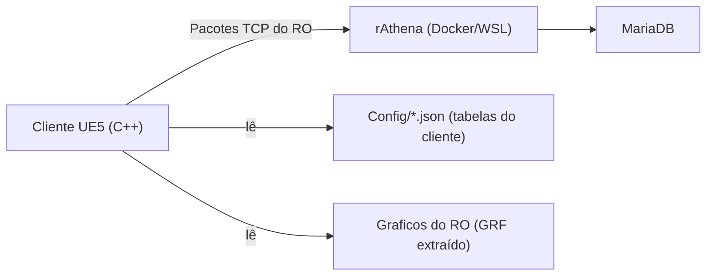

# ⚡ Myth of Thor

Remasterização de **Ragnarok Online** na **Unreal Engine 5.8** (C++), conectada a um servidor **rAthena** pelo protocolo de rede
original. O cliente é feito para ser **1:1 com o Ragnarok Online LATAM**; só depois entram o visual HD-2D e os sistemas próprios.

---

## 1. Princípios

1. **O servidor decide, o cliente mostra.** Nenhuma regra do rAthena é reimplementada no cliente (dano, drops, fórmulas, skills):
   o cliente envia pedidos e desenha o que o servidor responde.
2. **Cliente 1:1 com o RO.** Janelas, HUD, sprites, animações, efeitos de skill, sons e comportamento seguem o cliente original
   (referências: LATAM, roBrowserLegacy, open-midgard, korangar). Cada divergência está em [`docs/FIDELIDADE.md`](docs/FIDELIDADE.md).
3. **Acréscimos só por cima:** sombras HD-2D (Lumen), clima, ciclo dia/noite e os sistemas próprios (Síntese, Grade, Monstro Raro,
   Códice de Mímir, HUD sem comandos), sem mudar o que o jogador já conhece.
4. **Sem ROPs.** Itens de cash do RO oficial viram quests; JCoins ficam de fora.

## 2. Regras do servidor

- **rAthena Renovação** (`db/re`), `PACKETVER 20250402`, repositório oficial `github.com/rathena/rathena`.
- Jogo **até a transclasse** (nível 125 de base / 70 de classe, atributos até 110), classes expandidas liberadas; **sem 3ª classe e sem Doram**.
- Detalhes: [`docs/PRERE_X_RENOVACAO.md`](docs/PRERE_X_RENOVACAO.md).

## 3. Estado atual

Já funciona (com testes do desenvolvedor; a aprovação final de cada item depende do teste do jogador):

- Login, lista de personagens, criação; movimento com rota em torno de obstáculos (A* sobre o `.gat`) e rota no minimapa.
- Sprites do jogador por classe, sexo, arma, escudo, cabeça e capa; animações de ataque por tipo de arma; falcão, montaria, carrinho.
- Combate, skills (efeitos extraídos das tabelas do roBrowser, círculo mágico, cursor de área), cast com aura por elemento.
- HUD refeita com a arte do LATAM: inventário, equipamento, skills (tooltip de pré-requisitos e descrição no botão direito), atributos,
  loja, Kafra, grupo, chat e comandos, troca entre jogadores, correio, banco, conquistas, guilda, pets, homúnculo, navegação.
- 47 mapas importados, mundo com cidades e campos; clima e ciclo dia/noite em desenvolvimento.
- Pacote para jogar em outro PC pela Radmin VPN: [`docs/ACESSO_EXTERNO.md`](docs/ACESSO_EXTERNO.md).

O que falta e a ordem dele: [`docs/ROADMAP.md`](docs/ROADMAP.md) (plano), [`docs/AUDITORIA_COMPLETA.md`](docs/AUDITORIA_COMPLETA.md)
(funções do RO), [`docs/CHECKUP_SKILLS.md`](docs/CHECKUP_SKILLS.md) (cobertura de efeitos de skill).

## 4. Arquitetura



- Regras das camadas: [`docs/ARQUITETURA.md`](docs/ARQUITETURA.md).
- Cliente: `Source/MythOfThor/` com `Network/` (sockets e pacotes), `Player/` (controle, movimento, rota), `Sprites/` (sprites, efeitos de
  skill, falcão), `World/` (mundo em rede, monstros, NPCs), `UI/` (HUD estilo LATAM), `Core/` e `Gameplay/`.
- Servidor: `server/` (Docker compose, NPCs customizados em `server/npc/custom/myth`, scripts de acesso externo e de Renovação).
- Tabelas do cliente: `Config/*.json`, geradas pelos scripts de `tools/` a partir do GRF e do roBrowser.

## 5. Estrutura do repositório

```text
mythofthor_project/
├── Source/MythOfThor/     # Código C++ do cliente (Unreal 5.8)
├── Config/                # Configuração da Unreal e tabelas JSON do cliente
├── Content/               # Mapas, materiais e assets importados
├── server/                # Docker do rAthena, NPCs customizados, acesso externo
├── tools/                 # Extração do GRF, geradores de tabelas, build de teste e de pacote
├── tests/                 # Testes de rede em Python (headless)
└── docs/                  # Roadmap, fidelidade, referências, sistemas próprios, relatórios
```

Documentos principais em `docs/`: `ROADMAP.md`, `FIDELIDADE.md`, `PLANO_CLIENTE_FIEL.md`, `HUD_MODERNA_PLANO.md`, `ARQUITETURA_REDE.md`,
`TESTE_JOGADOR.md`, `ref/` (especificações do comportamento do cliente original) e `sistemas/` (sistemas próprios planejados).

## 6. Como rodar

**Pré-requisitos:** Unreal Engine 5.8, Visual Studio com C++, WSL2 com Docker, o `data.grf` do cliente LATAM (não incluído).

1. **Servidor** (WSL): `docker compose up -d` em `server/` (db, login, char, map). Contas de teste em `server/*.sql`.
2. **Gráficos do RO:** extrair o GRF com `tools/grf_extract.py` para a pasta de assets (o jogo procura `RagnarokAssets/grf`
   ao lado do executável ou o caminho dado em `-MythAssets=`).
3. **Cliente:** abrir `MythOfThor.uproject` (ou compilar com `tools/build_watch.ps1`) e jogar o mapa `Lvl_Prontera`.
   O endereço do servidor padrão é local; `-MythHost=<ip>` troca.
4. **Pacote de teste:** `tools/make_test_build.ps1` (local) e `tools/make_friend_build.ps1 -ServerIp <ip>` (outro PC, via Radmin VPN).
5. **Testes de rede:** `python tests/ragnarok_net_test.py`.

> O projeto fica em um caminho com acento; o compilador do MSVC não gosta dele, então compile por uma junção sem acento
> (ex.: `E:\Dev\mythofthor`).

## 7. Roteiro resumido

1. **Cliente 1:1** (em andamento): fechar as divergências de `FIDELIDADE.md` e a auditoria completa.
2. **Teste fechado** com cerca de 20 amigos hospedado no PC do desenvolvedor.
3. **Sistemas próprios:** Síntese, Grade, Monstro Raro, Códice de Mímir, HUD sem comandos.
4. **Visual HD-2D:** sombras, clima, ciclo dia/noite, aura do nível 99 com luz.
5. **Conteúdo novo** (mundo contínuo por regiões, posturas de papel e MVP por ameaça: `docs/SISTEMA_ESPECIALIZACOES_ROLES.md`).

## 8. Colaboração

Dois agentes de IA trabalham no projeto: **Claude** (cliente Unreal, HUD, efeitos, rede do cliente) e **Antigravity** (pesquisa
de referências, auditoria do servidor). A divisão e os pedidos ficam registrados em `docs/` (ver `HANDOFF_*.md`).
