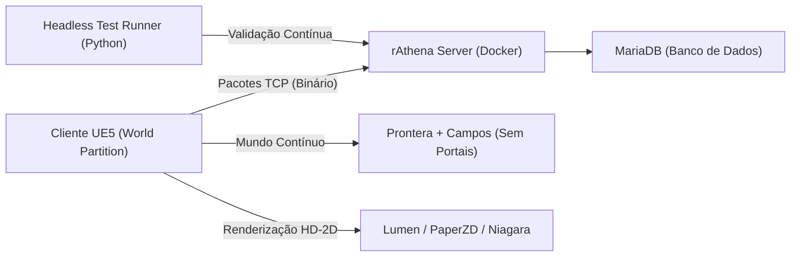

# ⚡ Myth of Thor Project

> Recriação nostálgica e moderna de Ragnarok Online no estilo **HD-2D** na **Unreal Engine 5**, conectada ao emulador oficial **rAthena** via protocolo de rede nativo de pacotes.

---

## 🎯 Visão do Projeto

* **Experiência Justa & Sem ROPs:** Modelo econômico puramente clássico e progressivo. Itens que antes eram vendidos por ROPs agora são adquiridos através de Quests temáticas no mundo. Manutenção do servidor viabilizada através de doações voluntárias com VIP exclusivamente cosmético/QoL.
* **Mundo Contínuo & Sem Telas de Carregamento (Seamless Open World):** Fim dos portais azuis e telas pretas de transição entre cidade e campos. O jogador cruza as muralhas de Prontera e entra diretamente nos campos abertos sem cortes de câmera ou loading.
* **Escopo Inicial (Vertical Slice):** Região Contínua de Prontera (Capital) conectada aos seus campos circundantes (`prt_fild08`) e ao Campo de Treinamento clássico (`new_1-1` a `new_1-4`).
* **Visual HD-2D na Unreal Engine 5:** Cenários 3D clássicos com iluminação dinâmica global (**Lumen**), reflexos em tempo real e sprites 2D com animações preservadas (**PaperZD**).
* **Ciclo Dia/Noite & Clima Dinâmico:** Transição suave entre dia, entardecer e noite (postes de luz acendendo em Prontera) e sistema de partículas (**Niagara**) para chuva, poças de água reflexivas e neblina.
* **Sistema de Auto-Battle Equilibrado:** Mecânica de auto-combate integrada com **limite de 3 horas diárias de vigor**, proteção contra sobrepeso ($\ge 90\%$) e desativação em mapas de desafio/PvP.

---

## 🏗️ Arquitetura do Sistema



* **Cliente:** Unreal Engine 5 (World Partition, C++ Sockets Subsystem, PaperZD, Niagara).
* **Servidor:** rAthena compilado via Docker (Login-Server, Char-Server, Map-Server).
* **Protocolo:** Pacotes nativos TCP (`PACKETVER 20211103`).
* **Testes:** Bateria de testes automatizados headless em Python (`tests/ragnarok_net_test.py`).

---

## 📁 Estrutura do Repositório

```text
mythofthor_project/
├── docs/                       # Documentação e Planogramas
│   ├── PLANOGRAMA.md           # Roteiro completo de marcos e sprints
│   └── ARQUITETURA_REDE.md     # Especificação dos pacotes binários
├── server/                     # Infraestrutura do Servidor (Docker / rAthena)
│   └── docker-compose.yml      # Configuração dos containers e banco de dados
├── client_ue5/                 # Fontes e especificações para a Unreal Engine 5
├── tests/                      # Suíte de testes automatizados
│   └── ragnarok_net_test.py    # Test runner headless de rede e lógica
├── tools/                      # Utilitários de conversão de assets
├── .gitignore
└── README.md
```

---

## 🧪 Como Executar os Testes Automatizados

```bash
# Executando no Windows ou Linux:
python tests/ragnarok_net_test.py
```
