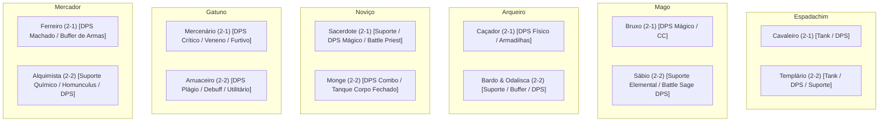

# ⚔️ Enciclopédia de Classes 2-1 e 2-2: Papéis e Habilidades (Myth of Thor)

> **Documento Oficial de Game Design de Classes**  
> Mapeamento completo de todas as 12 classes 2-1 e 2-2 do Ragnarok Online adaptadas para a **Trindade Moderna de MMORPG (Tanque, DPS e Suporte)**.

---

---

## 1. Ramo do Espadachim

### 🛡️ Cavaleiro (Knight - 2-1)
* **Tanque Principal:** Espada de 1 Mão + Escudo com a mecânica de **Provocar (Taunt Real)** para travar alvos e MVPs em si, *Vigor* para não tomar recuo e *Contra-Ataque* para aparar golpes físicos.
* **DPS Físico de Área:** Lança de 2 Mãos ou Espada de 2 Mãos com *Impacto de Tyr (Bowling Bash)*, *Perfurar* e *Brandir Lança*.

### ⚔️ Templário (Crusader - 2-2) — *A Classe Híbrida Suprema*
* **Tanque Protetor:** *Bloqueio (Auto Guard)* para negar ataques físicos e **Redenção (Devotion)** para absorver todo o dano recebido por aliados frágeis do grupo.
* **DPS Sagrado/Híbrido:** *Crux Divinum* (dano físico sagrado) e *Crux Magnum (Grand Cross)* (dano mágico massivo em área de luz).
* **Suporte / Paladino de Luz:** Pode aprender *Cura* e conceder auras de proteção e aumento de Max HP para o grupo.

---

## 2. Ramo do Mago

### 🧙 Bruxo (Wizard - 2-1)
* **DPS Mágico Puro & Controle de Grupo (CC):** O maior dano em área do jogo. *Nevasca (Storm Gust)* para congelar salas inteiras, *Chuva de Meteoros* para atordoamento e *Pântano dos Mortos (Quagmire)* para reduzir velocidade e esquiva dos inimigos.

### 📚 Sábio (Sage - 2-2)
* **Suporte Elemental & Antimagia:** Pode **encantar a arma de qualquer aliado com fogo, água, terra ou vento**. Usa **Proteger Terreno (Land Protector)** para anular magias de chão de chefes (como Nevasca de MVPs) e *Desencantar (Dispell)* para remover buffs de alvos.
* **DPS Battle Sage (Auto-Cast):** Foco em AGI com livros e maças; a cada ataque físico básico, a habilidade *Desejo Arcano (Hindsight)* conjura magias de Mago automaticamente sem gastar SP.

---

## 3. Ramo do Arqueiro

### 🏹 Caçador (Hunter - 2-1)
* **DPS Físico Rápido à Distância:** Disparo único contínuo (*Rajada de Flechas*) sincronizado com o ataque automático do **Falcão**.
* **Controle Tático:** Uso de armadilhas no chão para imobilizar monstros (*Armadilha Luminosa*), queimar SP ou cegar.

### 🎵 Bardo (Masculino) & 💃 Odalisca (Feminina) (2-2)
* **Buffer Supremo de Grupo (Suporte):**
  * Bardo usa **Poema de Bragi** (reduz o tempo de conjuração e o delay de todas as magias do grupo).
  * Odalisca usa **Não Me Abandone** e **Dança Cigana** (aumenta velocidade de ataque e SP do grupo).
  * Duetos (em conjunto): *Banquete de Niembelung* (aumenta o ganho de EXP do grupo!).
* **DPS de Chicote / Instrumento:** Alto dano à distância usando *Vulcão de Flechas*.

---

## 4. Ramo do Noviço

### ✨ Sacerdote (Priest - 2-1)
* **Suporte / Healer Tradicional:** *Cura*, *Aumentar Agilidade*, *Bênção*, *Kyrie Eleison*, *Magnificat* (regeneração de SP triplicada) e *Ressurreição*.
* **DPS Mágico Sagrado:** *Magnus Exorcismus* e *Luz Divina* adaptados para ferir qualquer elemento de monstro.
* **Battle Priest (DPS Físico):** Foco em FOR/AGI com Maças, usando *Fúria Divina* e *Glória* para atingir 100% de taxa crítica com ataques físicos sagrados.

### 🥋 Monge (Monk - 2-2)
* **Tanque Inquebrável (Muralha):** Ativa **Corpo Fechado (Mental Strength)**: ganha **90% de redução de todo o dano do jogo** e usa Provocar/Taunt. Pode segurar os chefes mais letais do jogo sem morrer.
* **DPS de Combos & Burst:** Sequência ininterrupta de socos marciais (*Golpe Triplo $\rightarrow$ Golpe Quádruplo $\rightarrow$ O Último Dragão*) culminando no lendário *Disparo de Esferas Espirituais* ou *Punho Supremo de Asura*.

---

## 5. Ramo do Gatuno

### 🗡️ Mercenário (Assassin - 2-1)
* **DPS Físico Furtivo & Crítico:** Katars de dano crítico dobrado sem gastar SP ou Adagas duplas elementais. Usa *Furtividade (Cloaking)* para passar invisível por perigos e *Tocaia (Grimtooth)* para atacar do subsolo em área.
* **DPS de Veneno:** Envenena armas com *Envenenar Arma* para enfraquecer o dano e a regeneração de chefes.

### 🎭 Arruaceiro (Rogue - 2-2)
* **DPS Mágico/Físico Curinga (Plágio):** Possui a habilidade **Plágio (Intimidate / Copycat)** para copiar permanentemente habilidades de outras classes (ex: Nevasca de Bruxo ou Impacto de Tyr de Cavaleiro).
* **Debuffer & Ladrão de Drops (Utilitário):** Usa *Mãos Leves (Gank)* para ter chance dobrada de roubar itens raros de monstros, e *Desarmar* para enfraquecer o ataque de inimigos.

---

## 6. Ramo do Mercador

### 🔨 Ferreiro (Blacksmith - 2-1)
* **DPS Brutal de Impacto:** Especialista em Machados de forja própria e maças. Usa *Golpe Estilhaçante*, *Adrenalina Pura* e *Força Excessiva* para ter altíssimo dano por segundo físico corpo a corpo.
* **Buffer de Grupo:** Compartilha *Manejo Perfeito (Weapon Perfection)* com o grupo todo (anulando penalidades de tamanho de monstros) e *Conserto de Armas*.

### 🧪 Alquimista (Alchemist - 2-2)
* **Curandeiro Químico (Healer Rápido):** Usa **Arremessar Poção (Potion Pitcher)**: arremessa poções brancas/azuis à distância nos aliados, curando muito mais rápido e mais forte do que a Cura tradicional de Sacerdote.
* **DPS Químico & Pet Master:** 
  * Ataca com *Terror Ácido* e *Fogo Grego*.
  * Invoca o seu **Homunculus** (companheiro com IA própria que ganha níveis, ataca e atua como tanque secundário para o Alquimista).
