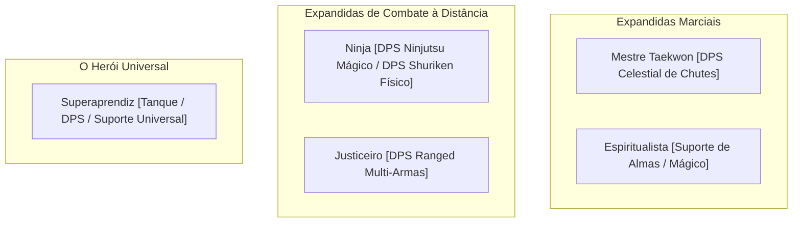

# 🥋 Enciclopédia de Classes Expandidas (Myth of Thor)

> **Documento Oficial de Game Design: Classes Expandidas**  
> Como o Myth of Thor opera no modelo clássico até o **Nível 99**, as Classes Expandidas competem de igual para igual com as classes tradicionais, trazendo papéis únicos na Trindade de MMORPG.

---

---

## 1. Ramo Taekwon

### ☀️ Mestre Taekwon (Star Gladiator)
* **Papel:** **DPS Físico Celestial de Ritmo Frenético**
* Luta desarmado usando sequências de chutes velozes das artes marciais.
* Alinha locais do mundo com o **Sol, a Lua e as Estrelas**, multiplicando exponencialmente o dano em dias ou mapas específicos.
* Habilidade de **Voo**: flutua sobre o campo de batalha com velocidade de movimento elevada e ataques aéreos (*Chute Aéreo*).

### 🔮 Espiritualista (Soul Linker)
* **Papel:** **Suporte Místico Único (Buffs de Almas) & DPS Mágico**
* **Espíritos Ancestrais (Soul Links):** Concede o "Espírito" para membros do grupo, destravando mecânicas ocultas nas outras classes:
  * *Espírito do Bruxo:* Magias sem custo de gemas mágicas.
  * *Espírito do Sacerdote:* *Luz Divina* com dano multiplicado e velocidade aumentada.
  * *Espírito do Bardo/Odalisca:* Permite cantar ou dançar sozinho sem o par de dueto.
* **DPS Mágico de Maldição (*Esma*):** Dispara rajadas concentradas de dano neutro/sombrio de altíssimo impacto mágico.

---

## 2. O Assassino das Sombras e o Pistoleiro

### 🥷 Ninja
* **Papel:** **DPS Híbrido (Mágico Elemental ou Físico de Projéteis / Evasor)**
* **Ninjutsu (Mágico):** Invoca artes de fogo (*Dragão de Fogo*, *Pétalas Flamejantes*), lanças de gelo e lâminas de vento à distância.
* **Físico (Shuriken & Kunai):** Lança projéteis de longa distância com sangramento e veneno.
* **Mecânica de Troca de Pele:** Substitui o corpo por um tronco ao tomar um golpe fatal, **anulando completamente 3 ataques físicos seguidos**.
* **Ataque Mortal:** Sacrifica o próprio HP para desferir um único golpe de corte de dano devastador.

### 🔫 Justiceiro (Gunslinger)
* **Papel:** **DPS Físico Ranged Especialista em 5 Armas Distintas**
* **Pistolas (Handguns):** *Reação em Cadeia* (disparo duplo contínuo) com altíssima velocidade de ataque e críticos rápidos.
* **Rifles:** Disparos de precisão de longa distância (*Tiro Certeiro*) com perfuração de armadura pesada (estilo Sniper).
* **Escopetas (Shotguns):** Disparos em área à queima-roupa com empurrão e atordoamento.
* **Gatling:** Dano contínuo esmagador com *Chuva de Balas*.
* **Lança-Granadas:** Projéteis explosivos com dano em área elemental.

---

## 3. O Herói Universal

### 🎒 Superaprendiz (Super Novice)
* **Papel:** **O Coringa Universal (Tanque, DPS ou Suporte)**
* Aprende simultaneamente as habilidades de quase todas as 1ª classes (*Cura*, *Golpe Fulminante*, *Lanças de Fogo*, *Furto*, *Aumentar Agilidade*, *Provocar*).
* **Tanque Superaprendiz:** Pode equipar escudos, usar *Provocar (Taunt Real)* e curar a si mesmo enquanto segura monstros com alta esquiva.
* **O Anjo da Guarda:** Em momentos críticos ou ao atingir metas de EXP, o Anjo da Guarda desce e restaura 100% de HP/SP e concede bênçãos sagradas.
