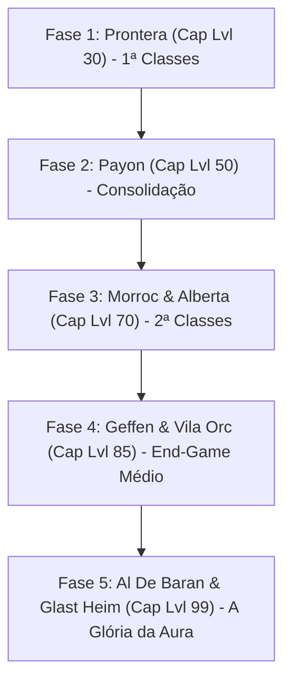

# 🗺️ Roteiro de Progressão de Níveis e Regiões (Myth of Thor)

> **Estrutura de Lançamento Progressivo em Fases (Level Cap Expansions)**  
> Cada região atua como uma expansão temática com seu próprio limite de nível, cidades, campos e dungeons correspondentes.

---

---

## 🟢 FASE 1: O Berço de Rune-Midgard (Prontera & Treinamento)
* **Level Cap:** **Nível 30 de Base / Nível 10 de Classe (Aprendiz $\rightarrow$ 1ª Classe)**
* **Objetivo:** Formatura no Campo de Treinamento, escolha da 1ª Classe e primeiras caçadas.
* **Cidades:** Prontera (Capital) e Campo de Treinamento (`new_1-1`).
* **Campos:** Arredores de Prontera (Porings, Fabres, Lunatics, Rockers, Mandrágoras).
* **Dungeon:**
  * **Esgotos de Prontera (`prt_sewb1` a `prt_sewb4`):** Besouro-Ladrão, Tarou, Esporo Venenoso.
  * **Chefe da Fase (MVP):** *Besouro-Ladrão Dourado (Golden Thief Bug)*.

---

## 🌲 FASE 2: A Floresta e os Espíritos (Payon)
* **Level Cap:** **Nível 50 de Base / Maximizando a 1ª Classe**
* **Objetivo:** Primeiras armas forjadas por Ferreiros, flechas elementais e primeiras cartas de dano.
* **Cidades:** Vila de Payon e Vila dos Arqueiros.
* **Campos:** Floresta de Payon (Lobos, Jaguares, Salgueiros Anciões, Pés-Grandes).
* **Dungeon:**
  * **Caverna de Payon (`pay_dun00` a `pay_dun04`):** Zumbis, Esqueletos, Eggyra, Munak, Bongun.
  * **Chefe da Fase (MVP):** *Flor do Luar (Moonlight Flower)*.

---

## 🏜️ FASE 3: O Deserto e o Grande Porto (Morroc & Alberta)
* **Level Cap:** **Nível 70 de Base / O Despertar das 2ª Classes!**
* **Objetivo:** **Avanço para a 2ª Classe** (Cavaleiro, Bruxo, Caçador, Ferreiro, Sacerdote, Mercenário). Desbloqueio de montarias (Peco-Peco) e falcões.
* **Cidades:** Morroc (Oásis do Deserto) e Alberta (Cidade Portuária).
* **Campos:** Deserto de Sograt (Mukas, Hodes, Areias, Lobos do Deserto).
* **Dungeons:**
  1. **Formigueiro Infernal (Ant Hell - Morroc):** Família de formigas e a rainha *Maya (MVP)*.
  2. **Navio Fantasma (Sunken Ship - Alberta):** Piratas Esqueletos e *Drake (MVP)*.
  3. **Ilha de Byalan (Submarino de Izlude):** Thara Frog, Hidras, Marinas e *Strouf (MVP)*.

---

## 🔮 FASE 4: A Cidade da Magia e a Fortaleza Orc (Geffen)
* **Level Cap:** **Nível 85 de Base / 2ª Classes Avançadas**
* **Objetivo:** Habilidades supremas de 2ª classe (Nevasca, Chuva de Meteoros, Lâminas Destruidoras, Impacto de Tyr).
* **Cidades:** Geffen (Cidade da Magia) e Acampamento da Vila dos Orcs.
* **Campos:** Campos de Geffen e Vila dos Orcs.
* **Dungeons:**
  1. **Calabouço dos Orcs (Orc Dungeon):** Orc Zumbi, Orc Esqueleto, *Herói Orc (MVP)* e *Senhor dos Orcs (MVP)*.
  2. **Calabouço de Geffen (Geffen Dungeon):** Deviruchi, Pesadelo e *Doppelganger (MVP)*.

---

## ⏳ FASE 5: A Torre do Tempo e a Cidadela Amaldiçoada (Al De Baran & Glast Heim)
* **Level Cap:** **Nível 99 de Base / Nível 50 de Classe (A Conquista da Aura 99!)**
* **Objetivo:** End-game absoluto clássico de Rune-Midgard. Equipamentos refinados (+7/+8), caça aos MVPs lendários e a corrida para o primeiro nível 99 do servidor.
* **Cidades:** Al De Baran (Cidade dos Canais) e ruínas de Glast Heim.
* **Campos:** Monte Mjolnir e arredores de Al De Baran.
* **Dungeons:**
  1. **Torre do Relógio (Clock Tower - Al De Baran):** Relógios, Alarmes, Pombos Mecânicos e *Executor*.
  2. **Glast Heim (A Maior Dungeon Clássica):** Raydric, Khalitzburg, Cavaleiro do Abismo e o lendário *Senhor das Trevas (Dark Lord - MVP)*.
