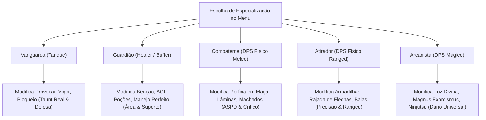

# 🌟 Sistema de Especializações e Modificadores de Habilidades (Myth of Thor)

> **Inovação Central de Game Design: Posturas de Papel (Role Modifiers)**  
> Em vez de conceder magias genéricas estranhas que descaracterizam a classe, o Myth of Thor permite escolher uma **Especialização de Papel** que aprimora e transforma as **habilidades originais** da classe para exercer a Trindade com qualidade de vida moderna.

---

---

## 📜 1. Como Funciona na Prática
* O jogador escolhe sua Especialização no painel de atributos/habilidades.
* A especialização pode ser alterada nas cidades ou em pontos de descanso.
* **A Regra de Ouro:** Nenhuma habilidade externa é injetada. O que muda é a **mecânica e o alcance das habilidades canônicas** da classe.

---

## 🛡️ 2. Modificadores por Classe

### A. Ramo do Noviço / Sacerdote
* 💚 **Especialização Guardião (Healer / Suporte):**
  * **Bênção & Aumentar Agilidade em Área:** Um único clique aplica o buff em **todos os membros do grupo ao redor**.
  * **Cura Protetora:** Curar aliados com vida cheia concede um escudo de absorção de dano equivalente a 15% do valor da cura.
* ⚔️ **Especialização Combatente (Battle Priest):**
  * **Perícia em Maça Turbinada:** Concede **+10% de Velocidade de Ataque (ASPD)** e **+15 de Taxa Crítica** passiva.
  * **Fúria Divina Ofensiva:** Converte ataques físicos de maça em dano sagrado com respingo em área.
* 🔮 **Especialização Arcanista (DPS Mágico):**
  * **Luz Divina Rápida:** Sem tempo de conjuração fixo e custo de SP reduzido.
  * **Magnus Exorcismus Universal:** **Causa dano a qualquer elemento e raça de monstro** (não apenas mortos-vivos e demônios).

---

### B. Ramo do Espadachim / Cavaleiro / Templário
* 🛡️ **Especialização Vanguarda (Tanque):**
  * **Provocar (Taunt Real):** Funciona em monstros comuns e **Chefes/MVPs**, forçando o foco no Tanque por 6 a 8 segundos.
  * **Vigor Protetor:** Reduz em 15% o dano recebido e anula recuo de golpes.
  * **Redenção Suavizada (Templário):** Reduz o dano transferido dos aliados em 25%.
* ⚔️ **Especialização Combatente (DPS Físico):**
  * **Impacto de Tyr Implacável:** Elimina bugs de paredes/quinas e adiciona chance de acerto crítico.
  * **Crux Magnum Puro (Templário):** Remove a penalidade de perda de vida do próprio usuário ao conjurar.

---

### C. Ramo do Mercador / Ferreiro / Alquimista
* 💚 **Especialização Guardião (Buffer / Curandeiro Químico):**
  * **Adrenalina Pura & Manejo Perfeito de Grupo:** Estendidos para **beneficiar qualquer arma e magia do grupo todo** (inclusive arcos e cajados).
  * **Arremessar Poção em Área (Alquimista):** Cura em raio de 3x3 células ao redor do aliado alvejado.
* ⚔️ **Especialização Combatente (DPS):**
  * **Golpe Estilhaçante Duplo:** Chance de 30% de desferir um segundo golpe automático instantâneo.
  * **Terror Ácido Devastador (Alquimista):** Destrói 20% da armadura do alvo por 10 segundos.

---

### D. Ramo do Mago / Bruxo / Sábio
* 💚 **Especialização Guardião (Suporte de Terreno - Sábio):**
  * **Encantar Armas em Grupo:** Encanta as armas de todos os aliados da party com fogo/água/vento/terra de uma só vez.
  * **Proteger Terreno:** Duração ampliada e dispensa uso de gemas mágicas.
* 🔮 **Especialização Arcanista (DPS Mágico):**
  * **Lanças Elementais:** Chance de ricochetear em alvos secundários.
  * **Desejo Arcano Turbinado (Battle Sage):** 40% de chance de auto-cast de magias em ataques corpo a corpo com livros.

---

### E. Ramo do Gatuno / Mercenário / Arruaceiro
* ⚔️ **Especialização Combatente (DPS Físico & Crítico):**
  * **Envenenar Vulnerável:** Alvos sob efeito de veneno recebem 15% a mais de dano de todos os membros da party.
  * **Lâminas Destruidoras Fluida:** Não trava a movimentação do Mercenário durante a animação de ataque.
  * **Plágio Amplificado (Arruaceiro):** Magias copiadas recebem escala adicional de dano baseada na Destreza e Agilidade do Arruaceiro.
